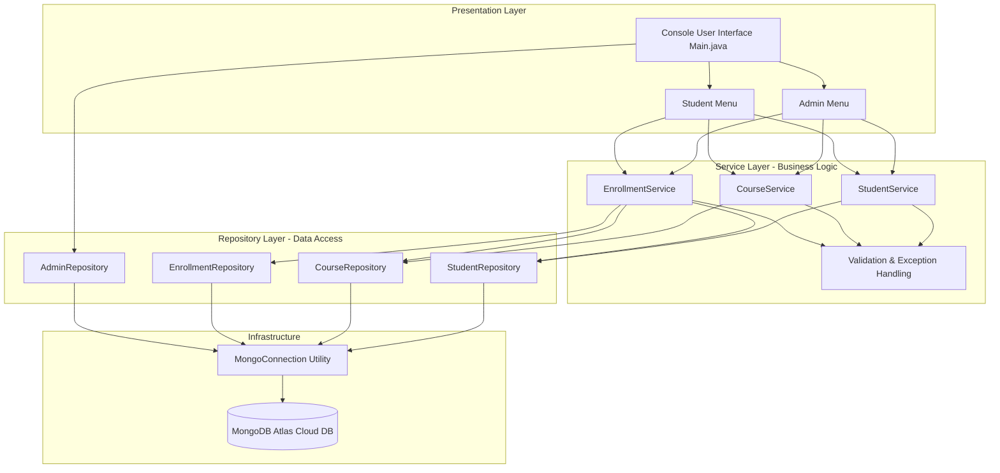
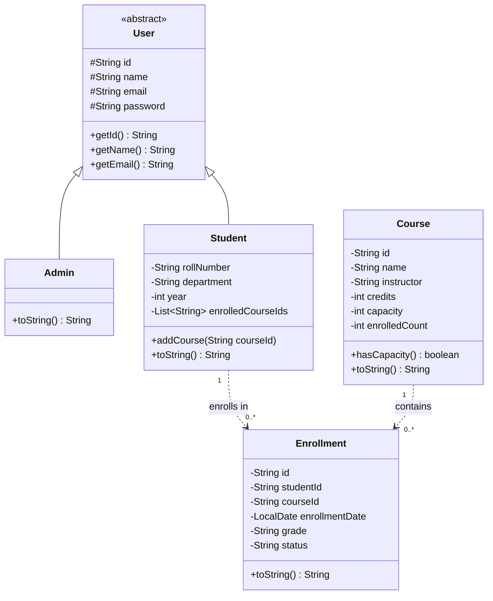
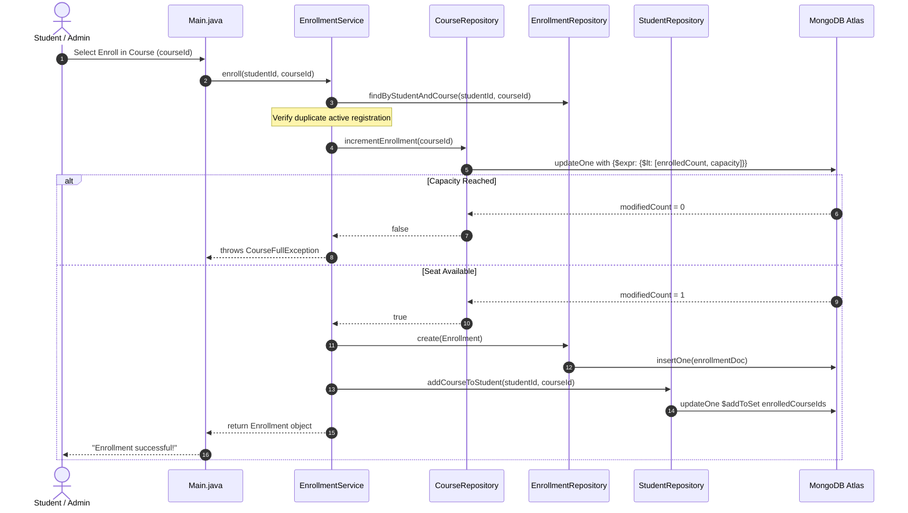

# Project Report: Student Management System

**Academic Year:** 2025–2026  
**Language & Runtime:** Java 17 LTS  
**Build System:** Apache Maven 3.9+  
**Database:** MongoDB Atlas (NoSQL Cloud Database)  

---

## 1. Executive Summary

The Student Management System (SMS) is an enterprise-patterned Java application designed to manage student academic life cycles, department offerings, course catalogs, and course enrollments. Built with a clean layered architecture, the application isolates user interaction from core business rules and MongoDB Atlas cloud operations.

---

## 2. System Architecture

---

## 3. Class Diagram

---

## 4. Enrollment Sequence Flow

---

## 5. Functional Modules

### 5.1 Admin Module
- **Student Management:** Full CRUD (Create, Read, Search by Roll Number, Update fields, Delete).
- **Course Catalog:** Create offerings with credits & seat capacities, update instructor/capacity, safe deletion (only if enrolled count == 0).
- **Enrollment Oversight:** View all active/past enrollments, assign grades (A, B, C, D, F), update enrollment status (ACTIVE, COMPLETED, DROPPED).
- **Analytics:** Most enrolled courses query using descending sort.

### 5.2 Student Module
- **Self-Service Profile:** View registration details and enrolled course list.
- **Course Browsing:** View available seats, course titles, instructors, and credit units.
- **Self-Enrollment:** Instant registration with immediate capacity check.
- **My Enrollments:** Real-time visibility into enrollment statuses and posted grades.

---

## 6. Verification and Test Results

The test suite validates:
1. **Student Model:** Attribute mapping and duplicate course prevention in local array.
2. **Course Model:** Real-time capacity computation and threshold boundaries.
3. **Enrollment Model:** Default status, date tracking, and grade updates.
4. **Validation Logic:** Regex email pattern checking and year boundaries (1–4).
5. **Exceptions:** Verification of `ValidationException`, `CourseFullException`, and `StudentNotFoundException`.

**Automated Test Result:** 27 / 27 Passed (100% Pass Rate).
